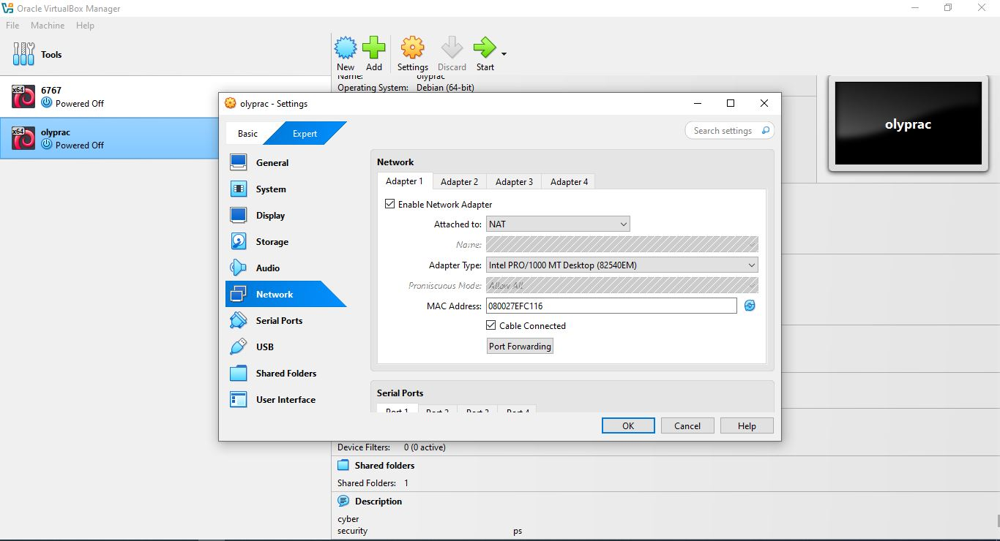
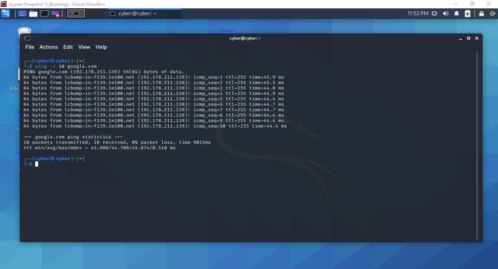
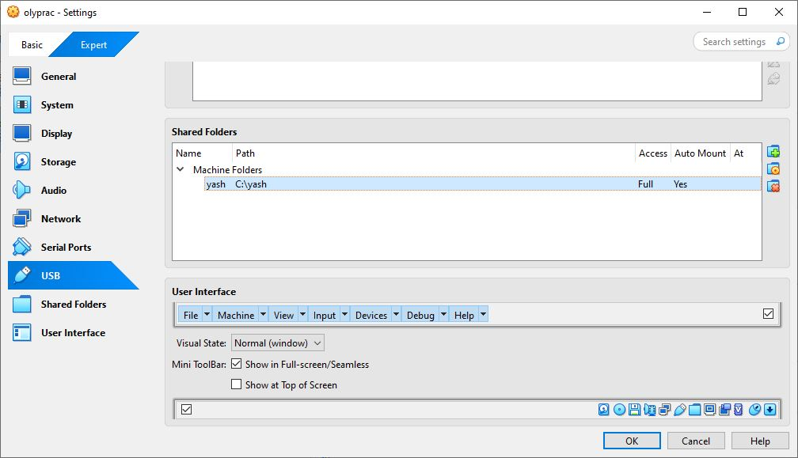
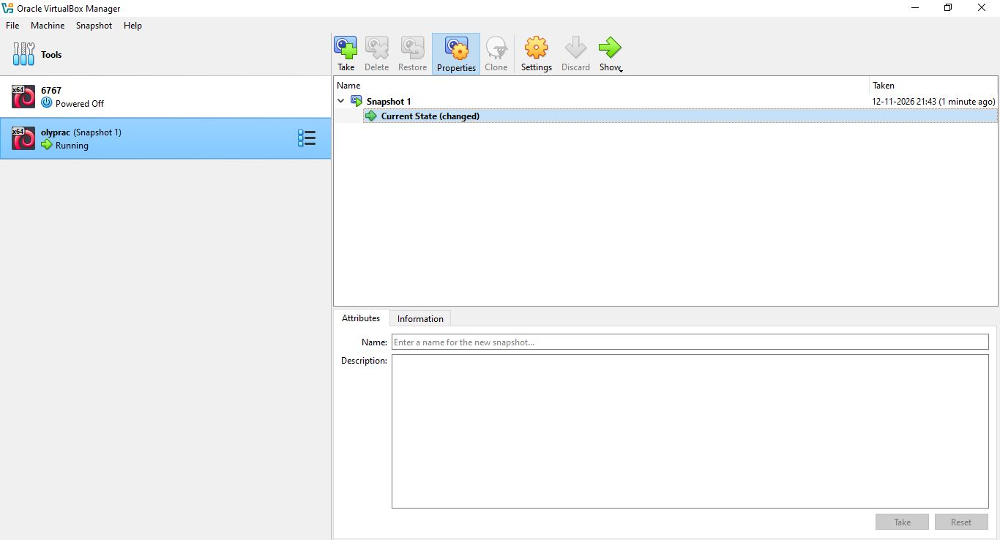

# 🛡️ Week 1: Cybersecurity & Hacking Lab Setup

Welcome to my personal Cybersecurity Lab repository. This project documents the step-by-step setup of a secure, isolated virtual environment designed for Ethical Hacking and Penetration Testing practice.

## 🎯 Project Objective
To build a fully functional, internet-enabled Virtual Machine (Kali Linux) inside a VirtualBox environment, isolated from the main host OS but capable of securely communicating over a dedicated network.

## ⚙️ Lab Requirements & Architecture
- **Host OS:** Windows 11
- **Hypervisor:** Oracle VirtualBox (Latest Version)
- **Attacker Machine:** Kali Linux (Latest 2026.1)
- **Network Type:** NATNetwork (Custom)
- **Subnet Range:** `10.0.0.0/24`
- **Kali IP Address:** `10.0.0.2/24` (Static)
- **Gateway:** `10.0.0.1`
- **DNS:** `8.8.8.8`

## 🛠️ Step-by-Step Setup Guide

### 1. VirtualBox Network Configuration
- Navigated to `File > Tools > Network Manager`.
- Created a new `NATNetwork` named "NatNetwork".
- Set the IPv4 Prefix to `10.0.0.0/24` and enabled DHCP.

### 2. Virtual Machine Settings
- Imported the Kali Linux VM.
- Changed the Network Adapter settings to **Attached to: NAT Network**.
- Enabled **Bidirectional Clipboard** and **Drag & Drop**.
- Added a shared folder: Path `C:\Users\[Username]\Downloads` mapped to `/downloads` in Kali.

### 3. Kali Linux IP Configuration
- Opened Network Settings > Wired Connection 1.
- Set the IPv4 Method to **Manual**.
- Added Address `10.0.0.2`, Netmask `24`, Gateway `10.0.0.1`.
- Added DNS Server `8.8.8.8` (used `10.0.0.1` as fallback).

## 🚨 Troubleshooting: No Internet Access
*(This is a common issue in VirtualBox v7 & Kali 2026.1+)*

If the VM fails to connect to the internet despite correct settings, the issue usually lies with the DAD (Duplicate Address Detection) timeout. 

Run the following commands in the Kali terminal to fix it:

```bash
sudo nmcli connection modify "Wired connection 1" ipv4.dad-timeout 0
sudo nmcli connection down "Wired connection 1"
sudo nmcli connection up "Wired connection 1"
Restarted the VM and the internet worked perfectly!
```

📸 Proof of Work & Screenshots
1. VirtualBox NAT Network Settings


2. Kali Linux Manual IP Configuration


3. Internet Connectivity Test (Ping)


4. Shared Folders Working


5. Clean Snapshot Taken


Author: Yash Raj

Connect with me: https://www.linkedin.com/in/yash-raj-ba4414312
