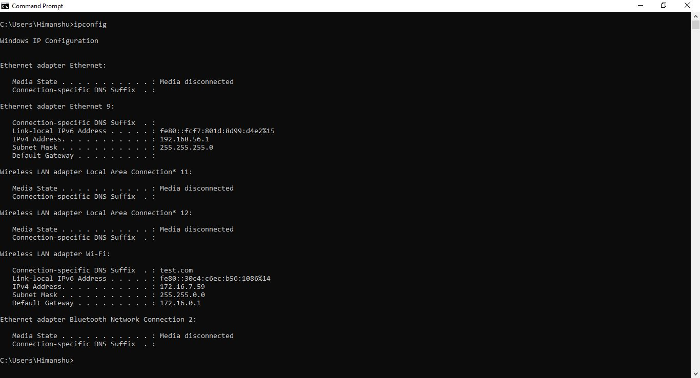
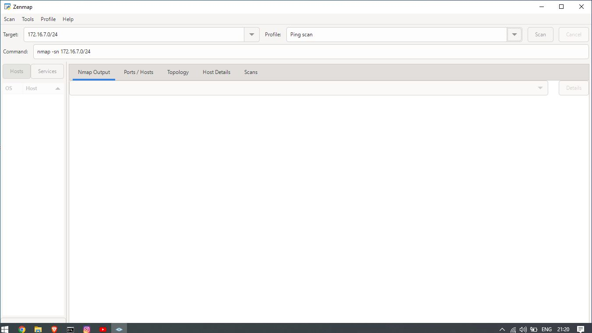
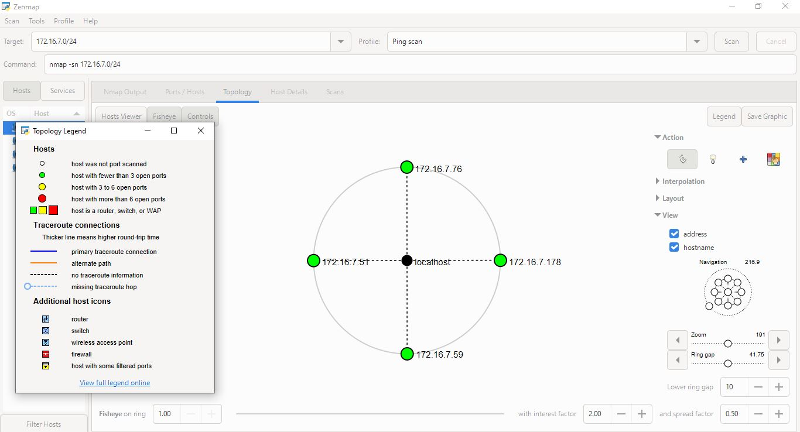

# 🌐 W2-PM5: Network Scanning with Zenmap

## 🎯 Objective
To use Zenmap (the official Nmap GUI) to perform host discovery on my local area network (LAN), identify live hosts, extract their MAC addresses, and generate a visual network topology.

## 🛠️ Step-by-Step Guide

1. **Identify Local Subnet:**
   * Opened Windows CMD and ran `ipconfig`.
   * Found my local IPv4 Address: `172.16.7.59` and Subnet Mask: `255.255.255.0`.
2. **Perform Ping Scan:**
   * Opened Zenmap, set Target to `172.16.7.0/24` and Profile to **Ping scan**.
   * *Command:* `nmap -sn 172.16.7.0/24`
3. **Analyze Results:**
   * The scan found **4 live hosts**:
     * `172.16.7.51` (Grandstream Networks)
     * `172.16.7.59` (My PC)
     * `172.16.7.76` (Grandstream Networks)
     * `172.16.7.178` (D-Link International)
4. **Topology Mapping:**
   * Clicked on the **Topology** tab, enabled the legend, and saved the graphical network map as a PDF.

## ⚠️ Challenges & Troubleshooting
* **Challenge:** Windows Firewall can sometimes block ICMP (Ping) requests, resulting in fewer hosts being discovered.
* **Solution:** Ensured that ICMP echo requests were allowed on the local network and ran Zenmap with administrative privileges to get accurate MAC address mappings.

## 📸 Evidence & Screenshots
**01-cmd-ipconfig**

**02-zenmap-ping-scan**

**03-zenmap-topology-map**

**zenmap-topology.pdf** (Attached PDF)

